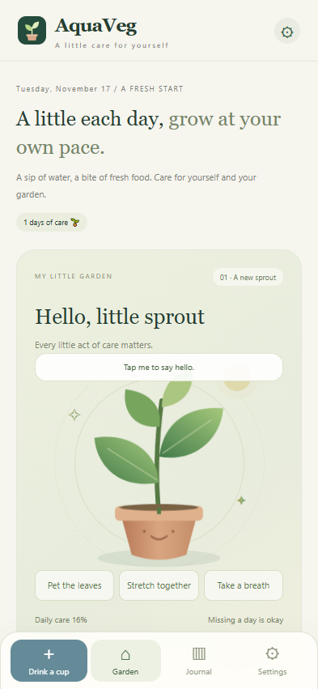

# AquaVeg 🌱

A little care each day. Track water, vegetables and fruit, and grow your own little plant.

[Download Android APK](https://github.com/Guo-4869/AquaVeg/releases/download/v0.3.0/AquaVeg-0.3.0.apk) · [All releases](https://github.com/Guo-4869/AquaVeg/releases) · [中文](README.md)

## Choose a language

Open **Settings → Language** and choose **English** or **简体中文**. The change applies immediately and is remembered after restarting. Records, goals and movement reminder timing remain unchanged. Android movement notifications and app error messages use your chosen language. System permission dialogs, the system file picker and linked references may use a different language.

This is a preview using fictional records, not a photo of a real phone.

## Daily care

- Log water with one tap, or enter a custom amount.
- Track vegetables and fruit separately using estimated edible portions.
- Say hello to your sprout, pet its leaves, stretch together or take a relaxing pause.
- Set movement reminder hours and intervals. Android notifications can vibrate and offer “I’ve moved” or “In 10 minutes”. These are timers, not automatic sitting detection.
- View daily progress and history. Export and restore a personal JSON backup.

Movement notifications need permission. Battery saving, Do Not Disturb and notification channel settings may delay or silence reminders. Force-stopping the app requires reopening it. Water reminders work only while the page is open. No widgets, cloud sync or photo recognition are included.

## Install and update

Android 9 or later is required. Install the new APK over the old version to keep your records; **do not uninstall first**. Export a backup before updating. `SHA256SUMS.txt` is available with each release.

The app is offline, with no ads or analytics. Notification, vibration and boot-restore permissions support movement reminders; it does not read contacts, location or motion sensors. Records stay on your device. Uninstalling or clearing app data deletes them. Do not post personal backups in public issues.

Version 0.1.0 was tested by the user on Magic8 / Android 17. Version 0.3.0 language features still require device verification; automated checks are not a guarantee of compatibility with every device.

Health targets are optional general references based on the Chinese Dietary Guidelines (2022), not individualized medical advice. Follow professional guidance for individual health needs.

## License

AquaVeg’s own software and assets use the [PolyForm Noncommercial License 1.0.0](LICENSE). Commercial use requires separate written permission. Third-party components retain their own licenses; see [notices](THIRD_PARTY_NOTICES.md). Contact the author through [Issues](https://github.com/Guo-4869/AquaVeg/issues).
