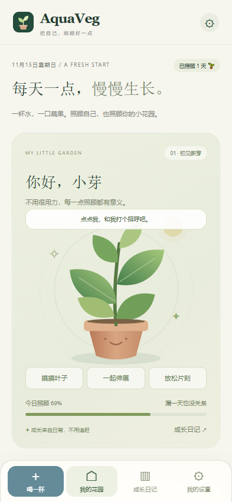
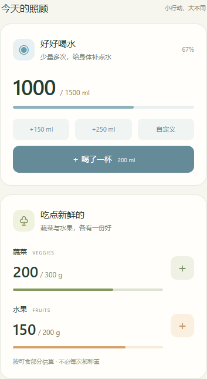
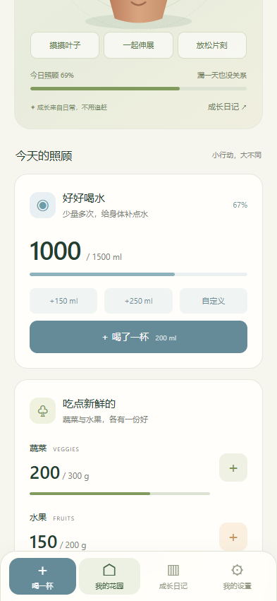
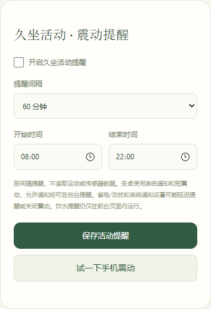

# AquaVeg 🌱

**每天一点，慢慢生长。**

一杯水，一口蔬果。用几秒钟记录日常饮水和蔬果摄入，让每一次照顾自己的小行动，都变成植物的新芽。

[下载 Android 安装包](https://github.com/Guo-4869/AquaVeg/releases/download/v0.2.0/AquaVeg-0.2.0.apk) · [版本与更新](https://github.com/Guo-4869/AquaVeg/releases) · [安装说明](INSTALL.md) · [问题反馈](https://github.com/Guo-4869/AquaVeg/issues)

## 轻一点，也能坚持

- **喝水只需点一下**：固定“喝一杯”入口，支持快捷杯量与自定义记录，记错可以撤销。
- **蔬果分开记**：选择估算份量或填写克数，随手记录每天吃下的新鲜食物。
- **照顾你的植物**：饮水和蔬果各自贡献成长，漏记不掉叶、不惩罚。
- **和小芽互动**：点击问候、摸摸叶子、一起伸展、放松动画。
- **久坐提醒**：安卓通知与短震动，支持静默时段、活动确认和稍后提醒。
- **看见自己的进步**：今日进度、七日趋势与历史记录，积累每一点改变。
- **按自己的节奏来**：调整个人目标、提醒时段与间隔，可以稍后提醒或跳过。
- **本机保存**：离线可用，无需账号；支持导出和恢复个人备份。

## 界面预览

以下是使用**虚构记录**制作的界面示例，不含真实健康数据，也不是手机实拍。

  
  
  
  

## 当前版本

**v0.2.0 · Android 测试版**，支持 Android 9 及以上。

0.1.0 曾由用户在 **Magic8 / Android 17** 上完成真机验证；本次 0.2.0 新功能仍待真机验收。不同系统和机型的表现仍可能不同，欢迎通过 Issues 反馈使用体验。

久坐活动提醒支持安卓系统通知和短震动，可设间隔与时段，并在通知中选择“已活动”或“10 分钟后”。需允许通知；省电、勿扰及系统通知设置可能延迟提醒或关闭震动，强行停止应用后需重新打开。饮水提醒仍仅在前台页面运行。小组件、拍照识别和家人协同暂未提供。

## 隐私与使用

开启活动提醒时会申请通知权限；使用震动和开机后恢复提醒所需权限。不读取运动传感器、通讯录或位置，不联网，不包含广告或分析 SDK。记录保存在当前应用中，不会自动上传；你主动导出的备份文件由你自行保管。卸载或清除应用数据会删除本机记录，请提前备份。

健康目标参考[中国营养学会《膳食指南（2022）》](https://www.cnsoc.org/bookpublica/0522202019.html)，可自行调整。成人参考值有适用条件，特殊健康需求应使用专业建议中的目标；本应用不替代医疗建议。蔬果份量为记录估算，不是称重或识别结果。

## 非商业使用许可

本产品自有部分采用 [PolyForm Noncommercial License 1.0.0](LICENSE)，允许许可范围内的非商业使用；商用须取得作者单独书面授权。见[中文说明](LICENSE.zh-CN.md)、[版权声明](NOTICE)和[第三方许可](THIRD_PARTY_NOTICES.md)。

商业合作请通过 [GitHub Issues](https://github.com/Guo-4869/AquaVeg/issues) 联系。请勿在公开反馈中提交真实健康记录、个人备份或其他私人信息。
